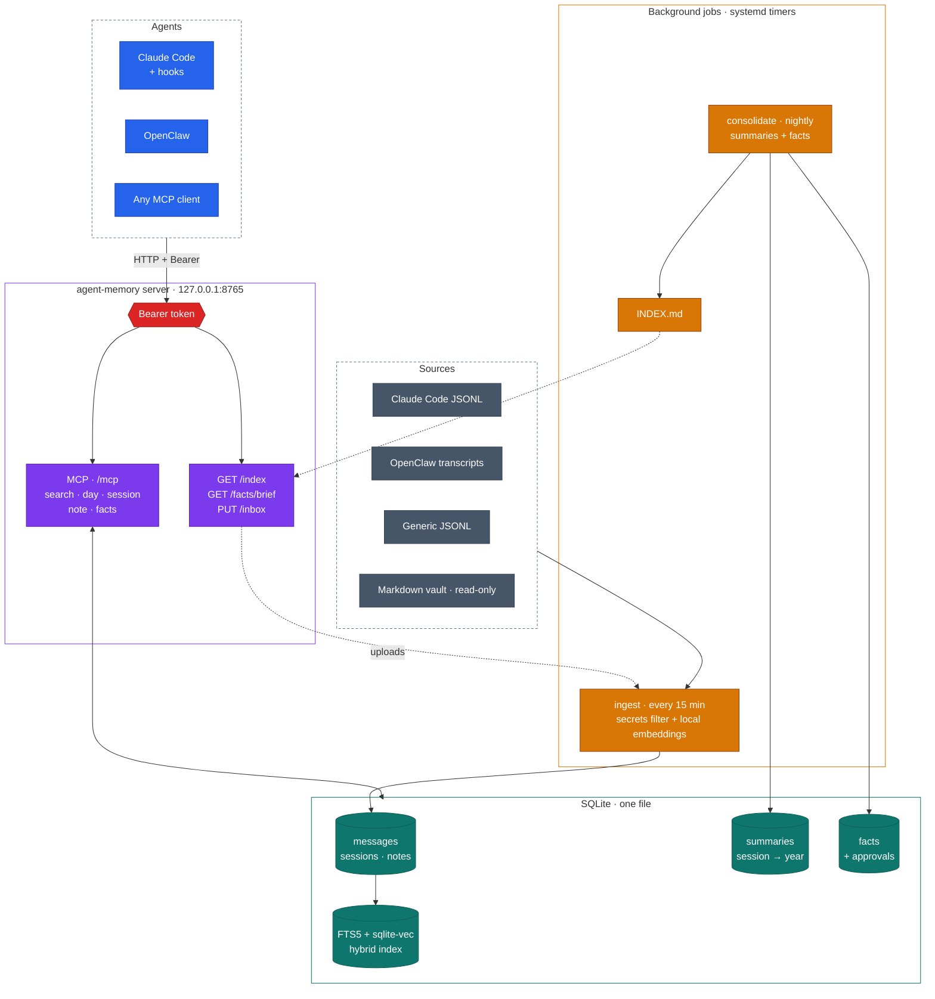
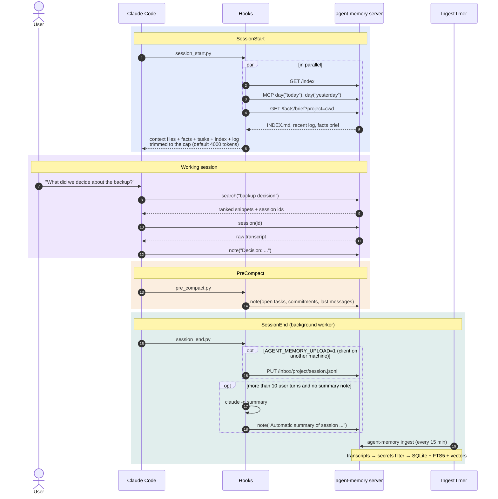
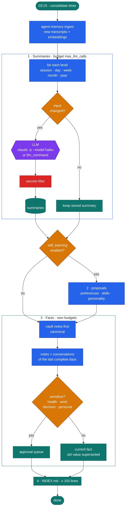
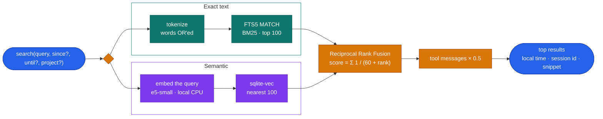

<div align="center">


<h1>agent-memory</h1>

<p><b>Long-term memory for AI agents: every conversation stored, searchable and summarized, served over MCP.</b></p>

<p>
<a href="LICENSE"></a>


<a href="https://github.com/AlexGHerrera/agent-memory/actions/workflows/tests.yml"></a>
</p>

<p>
<a href="#quickstart">Quickstart</a> ·
<a href="#how-it-works">How it works</a> ·
<a href="#the-five-tools">Tools</a> ·
<a href="#security-model">Security</a> ·
<a href="#faq">FAQ</a> ·
<a href="INSTALL.md">INSTALL.md</a> ·
<a href="AGENTS.md">AGENTS.md</a>
</p>

</div>

---

## Why

Agents forget. Every new session starts from zero, context compaction throws details away, and "what did we
decide last Tuesday?" has no answer. agent-memory keeps the agent's whole history with its user in one local
SQLite file, makes it searchable by exact words and by meaning, condenses it every night into
session → day → week → month → year summaries plus a list of **current facts** about the user, and hands it
back to the agent through five small MCP tools and a capped context block at session start.

It runs on your machine: local CPU embeddings, no vector database service, no cloud API required (the nightly
summaries use the Claude Code CLI login by default, or any command-line LLM you configure).

## Features

<table>
<tr>
<td width="33%" valign="top">

**🔎 Hybrid search**<br>
SQLite FTS5 (BM25, accent-insensitive) and sqlite-vec vectors fused with Reciprocal Rank Fusion. Filters by date
range and project.

</td>
<td width="33%" valign="top">

**🧠 Layered memory**<br>
Raw transcripts, nightly summaries at five levels, and a ≤150-line `INDEX.md` that fits in any prompt.

</td>
<td width="33%" valign="top">

**📌 Facts with history**<br>
"What is true today" about the user, each fact with its source session. New values supersede old ones; nothing is
deleted. Sensitive categories wait for approval.

</td>
</tr>
<tr>
<td valign="top">

**🔌 Five MCP tools, no more**<br>
`search`, `day`, `session`, `note`, `facts` over MCP streamable HTTP with a Bearer token.

</td>
<td valign="top">

**🪝 Claude Code hooks**<br>
SessionStart context injection under a hard token cap, PreCompact note, SessionEnd summary and optional upload.
Fail-open, stdlib only.

</td>
<td valign="top">

**📥 Many sources**<br>
Claude Code JSONL, OpenClaw transcripts, a read-only Markdown vault (e.g. Obsidian), and a documented generic
JSONL format for any other agent.

</td>
</tr>
<tr>
<td valign="top">

**🛡️ Secrets filter**<br>
Cards, API tokens, private keys, URL credentials, `password=…`, cookie dumps and hashed literal secrets are
redacted before anything is stored.

</td>
<td valign="top">

**⚙️ Agent-installable**<br>
Idempotent, non-interactive `install.sh`, systemd timers, a smoke test that calls every tool, and step-by-step
docs written for AI agents.

</td>
<td valign="top">

**🌍 English and Spanish**<br>
Summaries, `INDEX.md` and the `day` view in `en` or `es`; multilingual embeddings; dates in your timezone.

</td>
</tr>
</table>

## Quickstart

Linux with Python ≥ 3.11 (or [uv](https://docs.astral.sh/uv/)) and systemd:

```bash
git clone https://github.com/AlexGHerrera/agent-memory.git ~/agent-memory && cd ~/agent-memory
./install.sh --timezone Europe/Madrid --language en      # venv, config, token, model, user services
scripts/smoke.sh --config ~/.config/agent-memory/config.toml --url http://127.0.0.1:8765   # 12/12 checks
scripts/register-claude-code.sh && scripts/install-hooks.sh    # optional: wire up Claude Code
```

The server listens on `http://127.0.0.1:8765/mcp`; the token is in
`~/.local/share/agent-memory/config/mcp-token` (mode 600). Full walkthrough with expected outputs, uninstall and
troubleshooting: [INSTALL.md](INSTALL.md).

> [!TIP]
> **Installing with an AI agent?** Tell it to read [AGENTS.md](AGENTS.md) and follow [INSTALL.md](INSTALL.md)
> literally. Every step has a verification command and its expected output.

## How it works

### Architecture



| Layer | What it holds |
|---|---|
| **Raw** | Every message after the secrets filter: source, machine, project, session, role, UTC time, local date. Idempotent (unique id per message) and incremental (per-file offsets). |
| **Search** | FTS5 index + 384-dimension vectors from `intfloat/multilingual-e5-small` (ONNX on CPU via fastembed). |
| **Summaries** | Session, day, ISO week, month, year. Regenerated only when their input changes. |
| **Facts** | Subject, attribute, value, category, validity interval and source session id. At most one current value per subject and attribute. |
| **Index** | `INDEX.md`: recent days, weeks, months, years, notes and projects, capped at 150 lines. |

### A session with the Claude Code hooks



The hooks never block a session: any failure is logged to `~/.local/state/agent-memory-hooks/hooks.log`, and notes
or uploads that cannot be delivered are queued and retried by the next hook.

### Nightly consolidation



Sessions are summarized once they have been idle for 30 minutes. Transcripts are passed to the model wrapped as
data (`<<<DATA … DATA>>>`, with an instruction to ignore anything inside), and fact candidates that look like
credentials are dropped whole. Work left over when a budget runs out is picked up the next night.

### Hybrid search



## The five tools

| Tool | What it does |
|---|---|
| `search(query, since?, until?, project?)` | Hybrid search across the whole memory. Dates are `YYYY-MM-DD` (inclusive); `project` matches partially. Returns up to 12 results with local date and time, session id, source and a snippet. |
| `day(date)` | "What did we do yesterday?": `day('yesterday')`, `day('today')` (also `hoy`/`ayer`) or `day('YYYY-MM-DD')`. Day summary, sessions with their ids and the notes of that day. |
| `session(id)` | Raw transcript of one session, exact text. Long sessions are paginated (`id#2`, `id#3`…); a unique id prefix is enough. |
| `note(text, project?)` | Saves a note: decisions, commitments, closing summaries. Secrets are filtered; up to 20 000 characters. |
| `facts(query?, category?, include_history?)` | Current facts about the user with their source ids. Categories: `health`, `work`, `decision`, `preference`, `personal`, `project`. `include_history` adds superseded values. |

The tool surface is deliberately fixed at five. The same server and token also serve `GET /index`,
`GET /facts/brief?project=<slug>` and `PUT /inbox/<dir>/<session>.jsonl` (transcript uploads); these are plain
HTTP routes, not tools.

## Configuration highlights

One TOML file, `~/.config/agent-memory/config.toml`, written by `install.sh`. Every option is documented in
[config.example.toml](config.example.toml).

| Option | Default | Purpose |
|---|---|---|
| `base_dir` | `~/.local/share/agent-memory` | Database, model, INDEX.md, token |
| `host` / `port` | `127.0.0.1` / `8765` | Bind address (loopback or private network only) |
| `timezone` / `language` | `UTC` / `en` | Local dates; language of summaries, INDEX.md and the `day` CLI view (`en`, `es`) |
| `user_name` / `assistant_name` | `the user` / `the assistant` | How prompts refer to the human and the agent |
| `[[claude_sources]]` | `~/.claude/projects` (set by install.sh) | Claude Code or generic JSONL folders |
| `[[openclaw_sources]]` | `~/.openclaw/agents` if it exists | OpenClaw agents to ingest |
| `vault_path` | empty (off) | Read-only Markdown vault, the canonical source of facts |
| `llm_command` | empty (use `claude -p --model haiku`) | Any CLI that reads a prompt on stdin and prints the reply |
| `max_llm_calls` | `80` | Summary calls per night |
| `facts_brief_excluded` | `["health"]` | Fact categories never injected at session start |
| `self_learning` | `false` | Nightly preference, skill and personality proposals |

Useful commands (all accept `--config FILE`):

```
agent-memory doctor                         # check the config, token permissions, sources, LLM, model
agent-memory stats                          # counts of messages, sessions, vectors, summaries, notes
agent-memory day yesterday                  # the day view, in the configured language
agent-memory search "backup" --since 2026-01-01
agent-memory facts --history
agent-memory proposals pending              # facts waiting for approval (JSON)
agent-memory proposals mark <id> applied    # or: rejected
agent-memory refilter [--apply]             # rerun the secrets filter over the stored data (dry run by default)
```

## Security model

> [!WARNING]
> The server speaks **plain HTTP**. Keep it on `127.0.0.1` (the default). For access from other machines, bind
> only to an address on an encrypted overlay network (WireGuard, Tailscale) or put a TLS reverse proxy in front.
> Never bind it to a plain LAN or a public network.

- **Bind check**: `0.0.0.0`, `::` and public addresses make the server refuse to start. DNS-rebinding protection
  validates the `Host` header (`allowed_hosts`); requests carrying a browser `Origin` are rejected.
- **Bearer token**: required on every HTTP request, compared in constant time. 64 hex characters, generated at
  install time into a 600 file and never printed or logged. The server refuses a token file readable by group or
  others.
- **Claude Code registration**: a `headersHelper` reads the token file on each connection, so the token is not
  copied into `~/.claude.json`. The `--header-mode` fallback for older Claude Code versions copies it there (the
  file is made 600) and shows it briefly in the process list.
- **Secrets filter**: runs on every text before storage and on all LLM output. Its known limits are listed in
  [`agent_memory/secrets_filter.py`](agent_memory/secrets_filter.py); use `exclude_sessions` for sessions that
  must never be stored.
- **Files and services**: umask 077 (700 directories, 600 files). The systemd units run sandboxed
  (`ProtectSystem=strict`, `PrivateTmp`, write access only to the data directory, plus the Claude Code state
  directories for the consolidation job). The vault is only ever read.
- **Backups**: the database holds your (filtered) conversations. Back it up with
  `sqlite3 memory.db ".backup copy.db"`, encrypt the copy and never commit it.

## Built for agents

agent-memory is not tied to one assistant. Anything that speaks MCP can use it:

- **Claude Code**: `scripts/register-claude-code.sh` registers the server (user scope) and
  `scripts/install-hooks.sh` adds the three hooks to `~/.claude/settings.json` (a backup is kept).
- **OpenClaw**: add an MCP server entry pointing to `http://127.0.0.1:8765/mcp` with the
  `Authorization: Bearer` header, and enable `[[openclaw_sources]]` so its transcripts are ingested. See
  [docs/OPENCLAW.md](docs/OPENCLAW.md).
- **Any other agent**: MCP streamable HTTP plus the Bearer header. To feed transcripts, write the generic JSONL
  format of [docs/INGESTION.md](docs/INGESTION.md) into a folder listed in `[[claude_sources]]`, or upload files
  with `PUT /inbox/...`.

[AGENTS.md](AGENTS.md) also contains usage guidance for the agent itself: when to call `day`, `search`, `facts`
and `note`, and what never to store.

## FAQ

<details>
<summary><b>Do I need an API key or a cloud service?</b></summary>

No. Embeddings run locally on the CPU. The nightly summaries call `claude -p --model haiku` with the Claude Code
login of the user running the service. If you prefer another model, set `llm_command` (for example
`["ollama", "run", "llama3.1:8b"]`): it receives the system prompt and the prompt on stdin and must print the
reply. Without any LLM, ingestion, search and the five tools still work; the nightly summary and fact calls
just fail (counted as `errors`) and are retried the next night.
</details>

<details>
<summary><b>How much disk and RAM does it need?</b></summary>

About 225 MB for the virtualenv and 465 MB for the embedding model (downloaded once), plus the database, which
grows with your history. The server keeps the ONNX model loaded: plan for about 1 GB of RAM.
</details>

<details>
<summary><b>Does it work on macOS?</b></summary>

Yes, without the systemd timers: `./install.sh --systemd none`, then run `agent-memory serve` under launchd (and
schedule `agent-memory ingest` and `agent-memory consolidate`). See the macOS notes in [INSTALL.md](INSTALL.md).
</details>

<details>
<summary><b>Can several machines share one memory?</b></summary>

Yes. Run the server on one machine, bind it to its address on an encrypted overlay network (WireGuard,
Tailscale). On each other machine, copy the token file over a secure channel, register the server with
`scripts/register-claude-code.sh --url http://<address>:8765`, install the hooks and set `AGENT_MEMORY_URL` and
`AGENT_MEMORY_UPLOAD=1`: transcripts are then uploaded at the end of each session (INSTALL.md, step 8). Never use a
plain LAN address: the server is plain HTTP.
</details>

<details>
<summary><b>What if a secret slips into a transcript?</b></summary>

The filter redacts known formats before storage (`[REDACTED:<rule>]`). If something gets through, extend the
filter or register the literal secret by hash with `scripts/make-literal-hashes.py`, then run
`agent-memory refilter` (dry run) and `agent-memory refilter --apply`. Sessions listed in `exclude_sessions` are
never stored at all.
</details>

<details>
<summary><b>Why only five tools?</b></summary>

Every extra tool costs context in every session and adds a way to misuse it. Five cover the questions an agent
actually asks its memory: what happened on a day, the detail of a session, a search, what is true now, and
"remember this".
</details>

<details>
<summary><b>Why are some facts "pending"?</b></summary>

Facts in the categories health, work, decision and personal that were extracted from conversations or notes need
the user's approval (`agent-memory proposals pending`, then `mark <id> applied` or `rejected`). Facts from your
own vault notes are current at once, and a rejected value is not proposed again for 30 days.
</details>

## Contributing

Issues and pull requests are welcome. Please keep the five-tool surface, never commit data or secrets, and add
tests for new behaviour.

```bash
python3 -m venv .venv && .venv/bin/pip install -e ".[test]"
.venv/bin/python -m pytest -q                          # unit tests: no network, no model (a hashing embedder is used)
scripts/smoke.sh --bin .venv/bin/agent-memory          # end-to-end on a throwaway instance, port 18765
```

The smoke test downloads the embedding model (~465 MB) into its temporary directory unless you pass
`--models-dir` pointing to an existing copy.

## License

[MIT](LICENSE) © the agent-memory contributors
